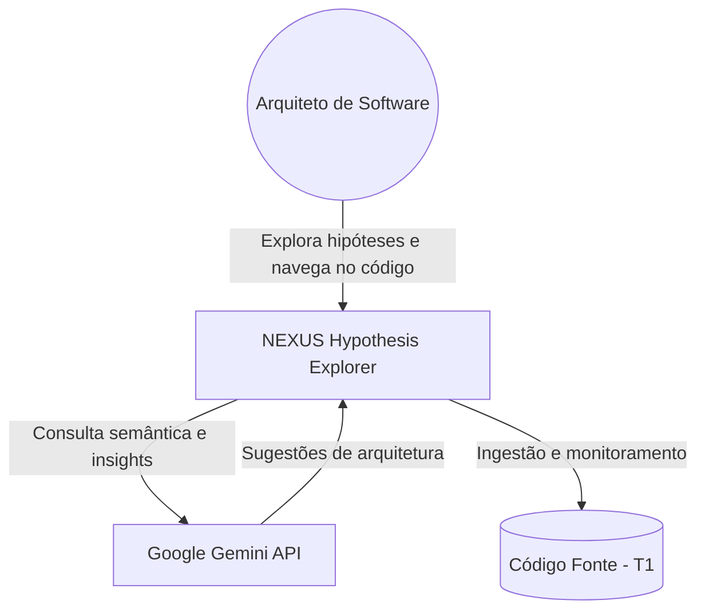
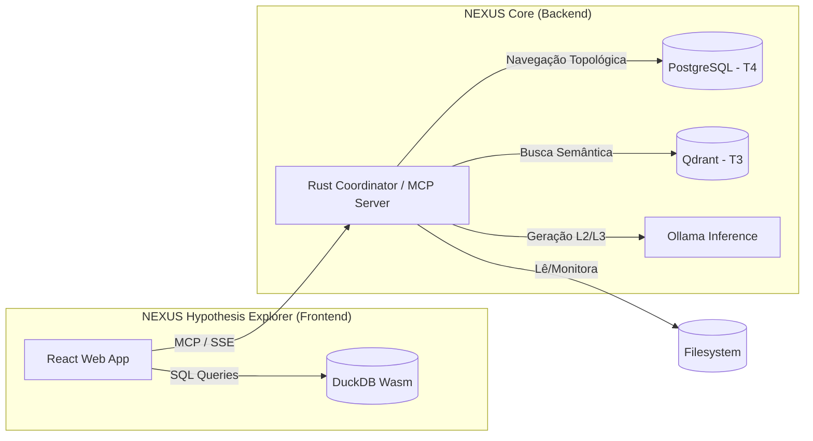
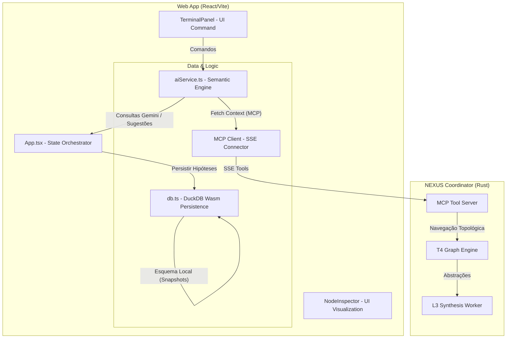

# Hypothesis Explorer - C4 Architecture Document

## Visão Geral

O Hypothesis Explorer é um "Digital Twin" de decisões técnicas que permite modelar, simular e avaliar arquiteturas complexas em tempo real, auxiliado por um motor de inferência local e um agente de inteligência generativa.

Este documento segue o modelo **C4** (Context, Containers, Components, Code) para descrever a arquitetura da aplicação.

---

## Nível 1: Contexto de Sistema (System Context)

Este nível define os limites do sistema integrado e como ele interage com atores humanos e sistemas externos. O NEXUS Hypothesis Explorer atua como uma ponte entre a exploração teórica (hipóteses) e a realidade estrutural (código fonte e grafos topológicos).

### Atores e Sistemas Relacionados:
- **Arquiteto de Software**: O usuário principal que interage com a plataforma para explorar hipóteses, navegar pela base de código e validar decisões arquiteturais.
- **Google Gemini (External AI)**: Atua como um motor de raciocínio de alta performance para sugestões proativas e análise complexa de arquitetura.
- **Sistema de Arquivos (T1)**: A fonte de verdade original que contém o código fonte e artefatos de engenharia.
- **NEXUS Hypothesis Explorer**: O sistema central que integra a memória externa semântica com o simulador de hipóteses.

---

## Nível 2: Contêineres (Containers)

O segundo nível detalha a decomposição do sistema em contêineres de software, destacando a separação entre a interface de exploração "fluida" e a memória "cristalizada" do NEXUS.

### Contêineres Principais:
- **Web App (React/Vite)**: Interface do usuário que fornece o terminal, o inspetor de nós e a visualização de grafos. É onde o "Digital Twin" de decisões é manipulado.
- **DuckDB Wasm (In-Browser DB)**: Motor SQL local que gerencia o estado das hipóteses, pipelines de decisão e snapshots temporais. Ele permite persistência robusta sem depender de um backend para cada interação de UI.
- **Coordinator (Rust)**: O "cérebro" do sistema. Gerencia o pipeline de abstração (L0 a L4), atua como servidor MCP (Model Context Protocol) e coordena os Nomad Workers.
- **PostgreSQL (T4 - Grafo Topológico)**: Armazena o grafo multi-relacional (arestas de hierarquia, dependência e pontes semânticas).
- **Qdrant (T3 - Espaço Vetorial)**: Atua como o "GPS Semântico", armazenando embeddings para busca por similaridade de intenção.
- **Ollama (Local Inference)**: Fornece modelos de linguagem locais para geração de abstrações L2/L3 e tarefas de reflexão arquitetural.

### Detalhes de Integração e Limites
- **Fronteira Epistêmica**: O Web App e o DuckDB lidam com dados fluidos/especulativos (hipóteses), enquanto o PostgreSQL (T4) mantém o conhecimento cristalizado/fato (o código real).
- **Comunicação**: A integração é mediada pelo protocolo MCP via SSE (Server-Sent Events), garantindo que o explorador de hipóteses possa invocar ferramentas como `nexus_query` e `nexus_adjacent` para hidratar sua visão com dados reais.

---

## Nível 3: Componentes (Components)

Neste nível, decompomos a Web App em seus serviços lógicos fundamentais e mostramos a ponte de comunicação com o NEXUS Coordinator.

### Detalhamento dos Componentes Internos

#### 1. App.tsx (O Orquestrador de Estado)
O componente central que gerencia o ciclo de vida da exploração. Ele coordena a exibição do ForkTree (histórico de hipóteses) e garante que as mudanças no terminal reflitam no banco de dados local.

#### 2. aiService.ts (O Motor Semântico e Cliente MCP)
Este componente é a peça de integração crítica. Ele desempenha três papéis:
- **Integração com Gemini**: Atua como o "Supervisor Técnico", gerando sugestões proativas (como a criação de novas regras ou nós de infraestrutura).
- **Ponte para o NEXUS**: Consome as ferramentas MCP (`nexus_query`, `nexus_adjacent`) para trazer fatos estruturais do grafo T4 (como dependências reais de código) para dentro da interface de hipóteses.
- **Filtro de Alucinação**: Implementa lógica de validação cruzada para garantir que as sugestões da IA não desviem drasticamente da realidade estrutural encontrada no NEXUS.

#### 3. db.ts (Persistência e Ponte Epistêmica)
Gerencia o DuckDB Wasm, que armazena o estado "fluido" da exploração.
- **Injeção de Esquema**: O banco é inicializado com tabelas para projects, pipelines (que representam ramos de hipóteses), nodes e suggestions.
- **Vínculos Epistêmicos**: O db.ts deve ser capaz de armazenar o `abs_id` (identificador do NEXUS) nos nós locais. Isso permite que uma hipótese de "refatoração" aponte diretamente para o código real que ela pretende modificar.

#### 4. O Loop de Inteligência de Background
O sistema opera em um ciclo de retroalimentação:
1. O Arquiteto propõe uma mudança via Terminal.
2. O aiService.ts consulta o NEXUS para entender o impacto estrutural dessa mudança (ex: "Se eu mover este serviço, o que quebra?").
3. O NEXUS responde com o subgrafo de dependências reais via ferramentas de trajetória.
4. O Gemini avalia o risco e gera uma "Sugestão" (tabela suggestions).
5. Se aceita, a sugestão é persistida no DuckDB e pode ser cristalizada de volta no NEXUS via `nexus_link`.

### Integração com Mecanismos Avançados do NEXUS
- **Propagação de Calor (Heat)**: Quando o usuário explora um nó no Frontend, o sistema dispara um sinal que aumenta o `heat` (calor) daquele nó no PostgreSQL do NEXUS. Isso sinaliza para outros agentes que aquela área da arquitetura é uma "zona quente" de interesse atual.
- **Ponte Epistêmica**: O Explorer utiliza metadados de confiança (`epistemic_weight`) para diferenciar o que é um fato do código real (fact) do que é uma mera hipótese especulativa da IA (speculative).

---

## Nível 4: Código e Estrutura de Dados (Esquema DuckDB)

O Hypothesis Explorer utiliza o DuckDB-Wasm para gerenciar o estado especulativo da arquitetura diretamente no navegador. Abaixo estão as definições das tabelas fundamentais que sustentam o motor de hipóteses:

### 1. Esquema de Tabelas (Persistência Local)

| Tabela | Colunas Principais | Propósito |
| :--- | :--- | :--- |
| **projects** | `id`, `name`, `description`, `created_at` | Metadados do projeto de exploração arquitetural. |
| **pipelines** | `id`, `project_id`, `name`, `parent_id`, `container_json`, `predicates_json` | Gerencia o ForkTree (ramos de hipóteses). O `parent_id` permite a herança de estados. |
| **nodes** | `id`, `pipeline_id`, `abs_id`, `name`, `type`, `properties_json` | Representa componentes. O `abs_id` é a chave estrangeira lógica para o nó real no NEXUS T4. |
| **suggestions** | `id`, `pipeline_id`, `node_id`, `agent_id`, `text`, `status` | Armazena propostas geradas pela IA (Gemini/Ollama) para cada cenário. |
| **snapshots** | `id`, `pipeline_id`, `timestamp`, `bin_data` | Armazena estados binários para Time Travel e recuperação de desastres. |

### 2. Lógica de Herança de Grafos e Predicados
A exploração é organizada em uma estrutura de ForkTree. Quando um arquiteto cria um novo "branch" de hipótese:
- **Herança**: O sistema utiliza o `parent_id` na tabela `pipelines` para rastrear a árvore de decisão.
- **Predicados Lógicos**: A coluna `predicates_json` armazena regras de validação (ex: "Este serviço não pode se comunicar com o banco legado sem um proxy"). Se uma hipótese viola um predicado, o Supervisor de IA sinaliza um conflito estrutural.

### 3. Ponte Epistêmica e Rigor de Navegação
Diferente de um banco tradicional, a integração com o NEXUS introduz o conceito de Ponte Epistêmica:
- **Pesos Epistêmicos**: Cada nó local pode ser marcado com metadados de certeza: `fact` (fato estrutural do NEXUS), `hypothesized` (proposto pelo arquiteto) ou `speculative` (sugerido pela IA).
- **Caminhada por Certeza**: As queries analíticas podem ser parametrizadas com `min_certainty`. Por exemplo, o sistema pode ocultar todas as conexões especulativas para focar apenas no que é estruturalmente garantido pelo grafo T4.

### 4. Snapshots e Backups Binários
O sistema utiliza o OPFS (Origin Private File System) para garantir alta performance e persistência.
- **Export SQL**: O estado atual do grafo de hipóteses pode ser exportado como um dump SQL completo para auditoria externa.
- **Backup Binário**: A tabela `snapshots` armazena o estado do banco em formato binário (`bin_data`), permitindo que o usuário restaure instantaneamente qualquer ponto na linha do tempo da exploração.

### Resumo da Integração de Dados
O segredo desta arquitetura é o `abs_id`. Ele funciona como uma âncora de realidade:
1. O usuário clica em um nó no Explorer.
2. O sistema usa o `abs_id` para disparar uma ferramenta MCP (`nexus_query` ou `nexus_adjacent`).
3. O NEXUS Coordinator retorna o subgrafo de dependências reais.
4. O Explorer injeta esses fatos no DuckDB local, permitindo que a IA compare a hipótese com a realidade estrutural.
